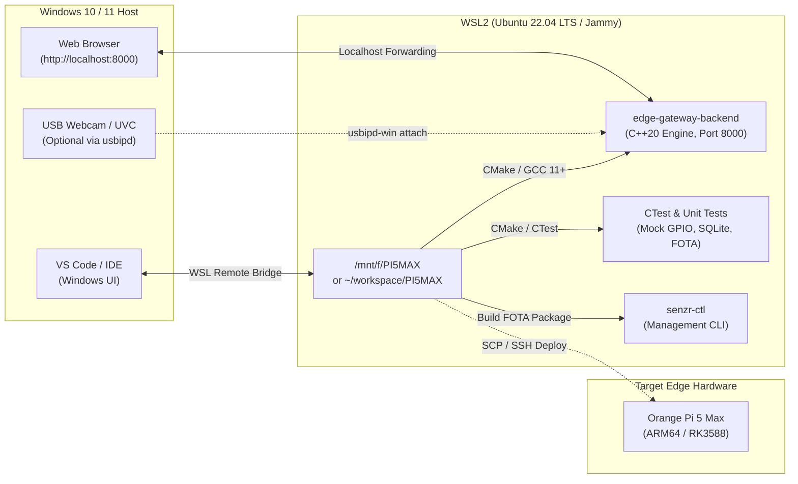

# Senzr Edge Gateway & SenzrOS — WSL2 Setup & Usage Guide

A comprehensive, production-grade guide for developing, compiling, testing, and debugging the **Senzr Edge Gateway** and **SenzrOS** C++ ecosystem inside **WSL2 (Windows Subsystem for Linux)** on Windows 10/11.

---

## 📑 Table of Contents

1. [Overview & Development Architecture](#1-overview--development-architecture)
2. [Step 1: Installing & Configuring WSL2 on Windows](#step-1-installing--configuring-wsl2-on-windows)
3. [Step 2: Project Workspace & File Access](#step-2-project-workspace--file-access)
4. [Step 3: Installing Build Tools & System Dependencies](#step-3-installing-build-tools--system-dependencies)
5. [Step 4: Compiling the C++ Core Engine & Utilities](#step-4-compiling-the-c-core-engine--utilities)
6. [Step 5: Running Unit Tests & CTest Suite](#step-5-running-unit-tests--ctest-suite)
7. [Step 6: Running the Edge Gateway Locally & Web Dashboard Access](#step-6-running-the-edge-gateway-locally--web-dashboard-access)
8. [Step 7: Hardware Simulation & USB Camera Passthrough](#step-7-hardware-simulation--usb-camera-passthrough)
9. [Step 8: IDE & VS Code Integration](#step-8-ide--vs-code-integration)
10. [Step 9: FOTA Release Packaging & Remote Board Deployment](#step-9-fota-release-packaging--remote-board-deployment)
11. [Step 10: Troubleshooting & Diagnostic FAQ](#step-10-troubleshooting--diagnostic-faq)
12. [Quick Reference Cheat Sheet](#quick-reference-cheat-sheet)

---

## 1. Overview & Development Architecture

Developing embedded Linux systems directly on physical target boards (like the Orange Pi 5 Max / RK3588) can be slow during rapid iteration. **WSL2** provides a complete, native Linux kernel environment directly on Windows, enabling:

- **Rapid Local Iteration:** Fast multi-core C++20 compilation using host CPU threads.
- **Hardware Abstraction Layer (HAL):** SenzrOS automatically selects `SENZR_PLATFORM=generic` on x86_64 hosts, enabling mock GPIO, simulated hardware telemetry, and local SQLite databases.
- **Full Test Suite Execution:** Run all CTest unit and integration tests locally before deploying to edge appliances.
- **Instant Web UI & API Verification:** The local backend daemon runs on port `8000` and is instantly accessible in your Windows browser via `http://localhost:8000`.



---

## Step 1: Installing & Configuring WSL2 on Windows

### 1.1 Enable Virtualization in BIOS / UEFI
Ensure **Intel VT-x** or **AMD-V / SVM** is enabled in your computer's BIOS/UEFI settings.

### 1.2 Install WSL2 with Ubuntu 22.04 LTS
Open **PowerShell** as **Administrator** on Windows and run:

```powershell
# 1. Update WSL kernel to the latest version
wsl --update

# 2. Set WSL2 as default version
wsl --set-default-version 2

# 3. Install Ubuntu 22.04 LTS
wsl --install -d Ubuntu-22.04
```

> [!NOTE]
> If Ubuntu is already installed, verify your active distribution and WSL version:
> ```powershell
> wsl -l -v
> ```
> Ensure the **VERSION** column shows **`2`**. If it displays `1`, convert it with:
> `wsl --set-version Ubuntu-22.04 2`

### 1.3 Create Initial User Account
When prompted during first boot, enter your UNIX username and password (e.g., username `senzr` or your name).

### 1.4 Optimize WSL2 Resource Allocation (`.wslconfig`)
To prevent WSL from consuming all host RAM during intensive multi-core C++ compilation, create or edit `%USERPROFILE%\.wslconfig` in Windows:

In Windows PowerShell:
```powershell
notepad $env:USERPROFILE\.wslconfig
```

Paste the following configuration:
```ini
[wsl2]
# Limit memory to 8GB (or 50-75% of your total RAM)
memory=8GB

# Use all CPU cores for fast parallel compilation
processors=8

# Allocate 4GB swap file
swap=4GB

# Enable automatic port forwarding to Windows localhost
localhostForwarding=true

# Keep Windows path interop
[interop]
enabled=true
appendWindowsPath=true
```

Restart WSL to apply the configuration:
```powershell
wsl --shutdown
```

---

## Step 2: Project Workspace & File Access

### 2.1 Locating Windows Drives inside WSL
Windows drives are automatically mounted under `/mnt/`. Your project directory `F:\PI5MAX` is accessible at:

```bash
/mnt/f/PI5MAX
```

Open WSL terminal (run `wsl` in Windows Terminal or PowerShell), and enter the project folder:

```bash
cd /mnt/f/PI5MAX
ls -la
```

### 2.2 Performance Best Practice: NTFS vs WSL Native ext4
You have two working options:

| Option | Location | Pros | Cons | Recommended For |
|---|---|---|---|---|
| **Option A: Direct Windows Mount** | `/mnt/f/PI5MAX` | Single folder, edits are immediately saved on Windows drive `F:` | NTFS cross-mount I/O is slightly slower for CMake builds | Daily editing, small builds, direct testing |
| **Option B: WSL Native Filesystem** | `~/PI5MAX` | Blazing-fast compilation speed (5-10x faster I/O) | Must sync or git pull separately from `F:` drive | Clean release builds, full test regression |

> [!TIP]
> If building directly on `/mnt/f/PI5MAX`, configure git to avoid Windows CRLF line ending conversion issues:
> ```bash
> git config --global core.autocrlf input
> ```

---

## Step 3: Installing Build Tools & System Dependencies

Inside your WSL terminal, update the package lists and install all required C++20 compilers, CMake, OpenCV, SQLite, and network development headers:

```bash
# 1. Update package index and upgrade packages
sudo apt-get update && sudo apt-get upgrade -y

# 2. Install essential compilers, CMake, and debugging tools
sudo apt-get install -y \
    build-essential \
    gcc \
    g++ \
    gdb \
    cmake \
    pkg-config \
    git \
    curl \
    wget \
    zip \
    unzip \
    tar

# 3. Install Senzr Edge Gateway dependencies
sudo apt-get install -y \
    libopencv-dev \
    libsqlite3-dev \
    libcurl4-openssl-dev \
    libssl-dev \
    nlohmann-json3-dev \
    libmosquitto-dev \
    libgpiod-dev \
    libasound2-dev \
    alsa-utils \
    v4l-utils
```

### 3.1 Verify Installed Tool Versions

```bash
# Check GCC version (Must be >= 11.2 for C++20 support)
gcc --version

# Check CMake version (Must be >= 3.20)
cmake --version

# Verify OpenCV 4
pkg-config --modversion opencv4

# Verify SQLite3
sqlite3 --version
```

---

## Step 4: Compiling the C++ Core Engine & Utilities

The Senzr Edge Gateway uses modern CMake with automatic platform detection. When building inside WSL2 (x86_64 host), it compiles in **Generic Host Simulation** mode.

### 4.1 Clean Build Directory
Always ensure the build directory is clean when switching between operating systems or architectures:

```bash
cd /mnt/f/PI5MAX/cpp

# Remove previous build cache
rm -rf build
mkdir -p build && cd build
```

### 4.2 Configure with CMake
Configure for **Debug** (with symbols for debugging) or **Release** (optimized):

```bash
# Debug Mode (Recommended for WSL Development & Testing)
cmake -DCMAKE_BUILD_TYPE=Debug -DSENZR_PLATFORM=generic ..

# Or Release Mode (Maximum Execution Speed)
# cmake -DCMAKE_BUILD_TYPE=Release -DSENZR_PLATFORM=generic ..
```

> [!NOTE]
> During CMake configuration on x86_64 WSL, you may see:
> `RKNN runtime not found — PersonDetectionWorker will not build`
> `whisper.cpp not found — StreamingTranscriber will not build`
> This is completely normal and expected on PC/WSL development hosts. The engine uses host-level fallbacks and mock handlers.

### 4.3 Compile Using All CPU Cores

```bash
make -j$(nproc)
```

### 4.4 Verify Generated Executables
Upon completion, the following binaries will be present in `/mnt/f/PI5MAX/cpp/build/`:

| Binary | Description |
|---|---|
| **`edge-gateway-backend`** | Main edge server (REST API on port `8000`, optical pipeline, database) |
| **`edge-gateway-updater`** | FOTA firmware update supervisor |
| **`senzr-ctl`** | Administrative hardware & telemetry CLI tool |
| **`edge-gateway-benchmark`** | In-memory performance and database benchmarking tool |
| **`test_*`** | Full test suite binaries (Device, GPIO, Storage, Network, FOTA, etc.) |

---

## Step 5: Running Unit Tests & CTest Suite

The SenzrOS SDK includes a comprehensive CTest test suite designed to run in host environments without requiring physical GPIO or RK3588 silicon.

### 5.1 Run the Full Test Suite with CTest

From `/mnt/f/PI5MAX/cpp/build`:

```bash
ctest --output-on-failure
```

Expected output:
```
100% tests passed, 0 tests failed out of 10
Total Test time (real) =   X.XX sec
```

### 5.2 Run Individual Test Binaries

You can execute test suites directly to inspect detailed assertion logs:

```bash
# 1. Device SDK & Telemetry Test
./test_device_sdk

# 2. GPIO Hardware Abstraction (Mock) Test
./test_gpio_sdk

# 3. Storage & Configuration SDK Test
./test_storage_sdk

# 4. Network Management SDK Test
./test_network_sdk

# 5. FOTA Updater & Rollback Test
./test_updater

# 6. BLE Access Manager Unit Test
./test_ble_sdk

# 7. Watchdog Supervisor Test
./test_watchdog_sdk
```

---

## Step 6: Running the Edge Gateway Locally & Web Dashboard Access

### 6.1 Start the Backend Server in Foreground

From `/mnt/f/PI5MAX/cpp/build`:

```bash
./edge-gateway-backend
```

You will see the startup banner:

```
======================================================
  🚀 SENZR EDGE GATEWAY C++ CORE ENGINE
  📡 Listening on: 0.0.0.0:8000
  ⚡ Vision Mode: Object & Number Plate Recognition
  🖥️ Platform Detected: Generic Linux / Host Dev
======================================================
```

### 6.2 Access from Windows Web Browser
Because WSL2 has automatic localhost forwarding, open any browser on Windows (Chrome, Edge, Firefox) and navigate to:

👉 **`http://localhost:8000`**

**Available in the Local Web Interface:**
- **Live Optical Stream / HUD Reticles:** Real-time video canvas with object & plate bounding boxes.
- **Vision Modes:** Switch detection filters (`All Combined`, `Plates`, `Vehicles`, `Persons`).
- **Media Gallery:** View captured snapshot metadata and event records.
- **Hardware Telemetry:** CPU load, RAM usage, and uptime graphs.

### 6.3 Test REST API Endpoints from Windows or WSL

You can test the API using `curl` or Postman from Windows or WSL:

```bash
# Check Gateway Status
curl http://localhost:8000/api/status

# Get System & Device Telemetry
curl http://localhost:8000/api/device/info

# Query Captured Plate Detections
curl http://localhost:8000/api/plates

# Pulse Door Relay (Mocked in Generic Host Mode)
curl -X POST http://localhost:8000/api/gpio/pulse \
  -H "Content-Type: application/json" \
  -d '{"pin":"DOOR_RELAY","duration_ms":1500}'
```

### 6.4 Execute Administrative CLI (`senzr-ctl`) in WSL

In a separate WSL terminal window:

```bash
cd /mnt/f/PI5MAX/cpp/build

# 1. Inspect System Information
./senzr-ctl device info

# 2. List GPIO Pin Map and Mock States
./senzr-ctl gpio list

# 3. Test GPIO Pulse
./senzr-ctl gpio pulse DOOR_RELAY 2000

# 4. Check Network Interfaces
./senzr-ctl net status
```

---

## Step 7: Hardware Simulation & USB Camera Passthrough

### 7.1 Forwarding a Physical USB Webcam from Windows into WSL2

If you have a USB webcam connected to your Windows PC and want to test real camera capture (`/dev/video0`) inside WSL:

#### 1. Install `usbipd-win` on Windows
In Windows **PowerShell (Run as Administrator)**:

```powershell
winget install --interactive --exact dorssel.usbipd-win
```
*(Restart your computer or PowerShell if prompted).*

#### 2. List Connected USB Devices
In Windows PowerShell (Administrator):

```powershell
usbipd list
```
Identify the **BUSID** of your webcam (e.g., `1-4` for "USB Video Device" or "Integrated Camera").

#### 3. Bind and Attach Device to WSL
In Windows PowerShell (Administrator):

```powershell
# Bind the device (Run once per device)
usbipd bind --busid <BUSID>

# Attach device to WSL2
usbipd attach --wsl --busid <BUSID>
```

#### 4. Verify in WSL2
Switch to your WSL terminal:

```bash
# Check USB device presence
lsusb

# Check video device node
ls -l /dev/video*

# Verify supported formats
v4l2-ctl --list-devices
```

The camera will now be available as `/dev/video0` for `edge-gateway-backend`!

#### 5. Detach Device when finished
From Windows PowerShell:
```powershell
usbipd detach --busid <BUSID>
```

---

## Step 8: IDE & VS Code Integration

### 8.1 VS Code with WSL Remote Extension
The most productive way to work with this codebase is using VS Code connected directly to WSL.

1. Install **Visual Studio Code** on Windows.
2. Install the **WSL** extension (`ms-vscode-remote.remote-wsl`) from the Extensions Marketplace.
3. Open your project in WSL:
   ```bash
   cd /mnt/f/PI5MAX
   code .
   ```
4. Recommended VS Code extensions to install inside the WSL container:
   - **C/C++** (`ms-vscode.cpptools`)
   - **CMake Tools** (`ms-vscode.cmake-tools`)
   - **Clangd** (optional, high-speed intellisense)

### 8.2 CMake Tools Integration in VS Code
With the CMake Tools extension installed:
- It automatically discovers `cpp/CMakeLists.txt`.
- Set the active kit to `GCC 11.4.0` (or `GCC 12/13`).
- Use the status bar to switch between `Debug` and `Release` builds.
- Press **F7** to build or **Ctrl + F5** to debug with GDB.

---

## Step 9: FOTA Release Packaging & Remote Board Deployment

Once your code is compiled and verified locally in WSL, you can build release bundles or deploy directly to the physical Orange Pi 5 Max board.

### 9.1 Build FOTA Release Package (.zip + SHA-256 Manifest)
In WSL:

```bash
cd /mnt/f/PI5MAX/cpp
bash build.sh 1.0.7
```

This compiles the release binaries, stages frontend files, calculates SHA-256 checksums, and produces:
- `releases/edge-gateway-v1.0.7.zip`
- `releases/latest.json`

### 9.2 Direct SSH / SCP Deployment to Orange Pi 5 Max

From WSL, you can copy files or trigger remote rebuilds over SSH:

```bash
# 1. SSH directly into the board from WSL
ssh orangepi@<BOARD_IP>

# 2. Transfer the FOTA package
scp releases/edge-gateway-v1.0.7.zip orangepi@<BOARD_IP>:/home/orangepi/edge-gateway/downloads/

# 3. Synchronize modified source files to the board
rsync -avz --exclude 'build' --exclude '.git' /mnt/f/PI5MAX/ orangepi@<BOARD_IP>:/home/orangepi/edge-gateway/
```

---

## Step 10: Troubleshooting & Diagnostic FAQ

### Q1: `http://localhost:8000` is not opening in Windows browser
1. Ensure `edge-gateway-backend` is actively running inside WSL.
2. Test from inside WSL first:
   ```bash
   curl http://127.0.0.1:8000/api/status
   ```
3. If it responds in WSL but fails in Windows:
   Find the WSL IP address:
   ```bash
   ip addr show eth0 | grep "inet "
   ```
   Open `http://<WSL_IP>:8000` in your Windows browser.
4. Verify `%USERPROFILE%\.wslconfig` contains `localhostForwarding=true`.

### Q2: CMake fails with `No CMAKE_CXX_COMPILER could be found`
Install the C++ compiler:
```bash
sudo apt-get install -y build-essential g++
```

### Q3: Build fails with `nlohmann/json.hpp: No such file or directory`
Install the JSON development package or verify third_party include:
```bash
sudo apt-get install -y nlohmann-json3-dev
```

### Q4: Bash scripts give error `: '\r': command not found`
This happens when files have Windows CRLF line endings. Fix with `dos2unix`:
```bash
sudo apt-get install -y dos2unix
dos2unix /mnt/f/PI5MAX/cpp/build.sh
dos2unix /mnt/f/PI5MAX/scripts/*.sh
```

### Q5: Out of Memory / WSL freezes during `make -j$(nproc)`
If compiling on a high-thread machine with limited RAM:
1. Limit parallel jobs:
   ```bash
   make -j4    # instead of make -j$(nproc)
   ```
2. Increase swap space in `.wslconfig` (e.g., `swap=4GB`).

### Q6: CMake cache conflict after editing files on Windows
Delete the build folder completely to ensure clean paths:
```bash
cd /mnt/f/PI5MAX/cpp
rm -rf build
mkdir build && cd build
cmake -DCMAKE_BUILD_TYPE=Debug -DSENZR_PLATFORM=generic ..
```

---

## Quick Reference Cheat Sheet

| Task | WSL Command |
|---|---|
| **Enter Project Folder** | `cd /mnt/f/PI5MAX` |
| **Configure CMake (Debug)** | `cd cpp && rm -rf build && mkdir build && cd build && cmake -DCMAKE_BUILD_TYPE=Debug -DSENZR_PLATFORM=generic ..` |
| **Compile All Targets** | `make -j$(nproc)` |
| **Run All Tests** | `ctest --output-on-failure` |
| **Run Main Server** | `./edge-gateway-backend` |
| **Check Backend Status** | `curl http://localhost:8000/api/status` |
| **Run System CLI** | `./senzr-ctl device info` |
| **Build FOTA Package** | `cd /mnt/f/PI5MAX/cpp && bash build.sh 1.0.7` |
| **Shutdown WSL (from Win)** | `wsl --shutdown` |
