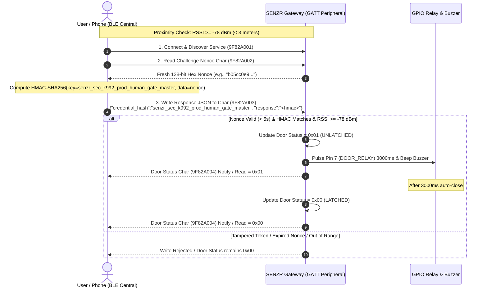

# Path 2: Physical SENZR Edge Gateway Testing Guide

This guide covers physical hardware testing for the **SENZR Edge Gateway & Access Controller** (Orange Pi 5 Max, Raspberry Pi, ESP32, or custom controller board).

---

## 1. Gateway BLE GATT Specification

| Requirement | Characteristic / Service | UUID | Properties | Description & Format |
|---|---|---|---|---|
| **BLE Service** | Access Service | `9F82A001-7B34-4C12-8921-5092A1B2C3D4` | — | Primary GATT Service advertised by Gateway |
| **Challenge Nonce** | Challenge Nonce Char | `9F82A002-7B34-4C12-8921-5092A1B2C3D4` | `Read`, `Notify` | Emits a fresh 128-bit random nonce upon read (valid for 5s) |
| **Response / Unlock** | Response Char | `9F82A003-7B34-4C12-8921-5092A1B2C3D4` | `Write with Response` | Receives authenticated JSON payload or HMAC-SHA256 hex token |
| **Door Status** | Door Status Char | `9F82A004-7B34-4C12-8921-5092A1B2C3D4` | `Read`, `Notify` | `0x01` = physical unlatch confirmed, `0x00` = latched |
| **Master Secret Key** | Pre-provisioned Key | `senzr_sec_k992_prod_human_gate_master` | — | Embedded in SQLite DB & BlueZ daemon |
| **Proximity Zone** | Actuation Range | $\ge -78\text{ dBm}$ | — | Phone within ~3 meters of antenna |

---

## 2. Authentication & Unlock Handshake Flow



---

## 3. Method A: Testing via Mobile App (nRF Connect / LightBlue)

### Prerequisites
1. Ensure the gateway software is running on the device:
   ```bash
   # On the Orange Pi 5 Max / gateway:
   senzr-ctl ble status
   # If inactive, start advertising:
   senzr-ctl ble start
   ```
2. Ensure you are standing **within 3 meters** of the gateway antenna (RSSI $\ge -78\text{ dBm}$).

### Step-by-Step Mobile Test
1. **Open nRF Connect** (available on iOS and Android).
2. Scan for devices and look for `SENZR` (MAC address `C0:F5:35:ED:F5:F2`) or device advertising Service `9F82A001-7B34-4C12-8921-5092A1B2C3D4`.
   *(For full hardware troubleshooting history and root cause breakdown, see [BLE Troubleshooting & Root Cause Post-Mortem](file:///f:/PI5MAX/docs/BLE_TROUBLESHOOTING_AND_ROOT_CAUSE_POSTMORTEM.md).)*
3. Tap **Connect**.
4. Expand Service `9F82A001-7B34-4C12-8921-5092A1B2C3D4`:
   - Tap the **Read** button (down arrow) on Characteristic `9F82A002-7B34-4C12-8921-5092A1B2C3D4`.
   - Copy the 32-character hexadecimal nonce emitted (e.g. `b05cc0e9a978ebd8d5d0565990065af9`).
5. **Compute HMAC Token** (using Python, CyberChef, or the Flutter test app):
   - Algorithm: `HMAC-SHA256`
   - Key: `senzr_sec_k992_prod_human_gate_master`
   - Data: `<nonce copied in step 4>`
6. Tap the **Write** button (up arrow) on Characteristic `9F82A003-7B34-4C12-8921-5092A1B2C3D4`:
   - Select **Text / UTF-8 String** or **JSON**:
     ```json
     {"credential_hash":"senzr_sec_k992_prod_human_gate_master","response":"<computed_hmac_hex>"}
     ```
   - Tap **Send**.
7. Observe the physical gateway:
   - **Relay clicks** (Pin 7 activates for 3000ms).
   - **Buzzer emits 2 short beeps**.
8. Read Characteristic `9F82A004-7B34-4C12-8921-5092A1B2C3D4`:
   - Value reads `0x01` during unlatch, reverting to `0x00` after 3 seconds.

---

## 4. Method B: Automated Testing via Python Test Script

A dedicated test script is provided in [`scripts/test_physical_ble_client.py`](file:///f:/PI5MAX/scripts/test_physical_ble_client.py).

### Mode 1: Over-the-Air Bluetooth (Requires `pip install bleak`)
Run from any laptop or mobile controller with Bluetooth:
```bash
python3 scripts/test_physical_ble_client.py --mode ble --secret senzr_sec_k992_prod_human_gate_master
```
This automatically scans for `9F82A001`, checks the RSSI proximity, performs the cryptographic handshake, writes the payload, and confirms `Door Status = 0x01`.

### Mode 2: Loopback / REST Simulation
Run locally or against the gateway IP:
```bash
python3 scripts/test_physical_ble_client.py --mode rest --url http://10.50.53.189:8080 --rssi -68
```
Sample Output:
```text
=======================================================
  SENZR PHYSICAL GATEWAY VERIFICATION (REST / LOOPBACK)
  Target: http://127.0.0.1:8080
  Secret: senzr_sec_k992_prod_human_gate_master
  RSSI  : -68 dBm (Threshold >= -78 dBm)
=======================================================

[1/5] Querying /api/ble/config ...
      Service UUID    : 9F82A001-7B34-4C12-8921-5092A1B2C3D4
      Challenge UUID  : 9F82A002-7B34-4C12-8921-5092A1B2C3D4
      Response UUID   : 9F82A003-7B34-4C12-8921-5092A1B2C3D4
      Door Status UUID: 9F82A004-7B34-4C12-8921-5092A1B2C3D4
      RSSI Threshold  : -78 dBm
[2/5] Requesting Challenge Nonce from gateway for MAC F4:B7:E2:89:12:34 ...
      Challenge Nonce: 9eb49f86a6f4c6ea2e4d67f6dd9802e5 (Freshness window: 5s)
[3/5] Computed HMAC-SHA256 Response: 4a2f8b...
[4/5] Transmitting Authenticated JSON Payload to Unlock Characteristic ...
      Authorized : True
      Door Status: 0x01 (0x01 = UNLATCHED)
      Message    : Access Granted - Door Relay Pulsed
[5/5] Querying Door Status Characteristic (UUID: 9F82A004) ...
      Status: 0x01 [UNLATCHED]

=======================================================
  [SUCCESS] PATH 2 PHYSICAL GATEWAY HANDSHAKE VERIFIED!
=======================================================
```

---

## 5. Method C: Running the Native BlueZ Peripheral Daemon on Linux

For boards running Linux (Orange Pi 5 Max, Raspberry Pi):
```bash
# Ensure Bluetooth is enabled
sudo hciconfig hci0 up
sudo systemctl restart bluetooth

# Launch the SENZR GATT Peripheral Daemon
python3 scripts/senzr_ble_peripheral.py
```
This registers the GATT application directly with BlueZ and begins advertising over the air.

---

## 6. Unit Testing Verification

To run the offline C++ test suite validating all Path 2 features:
```bash
./build_linux/test_ble
```
Output:
```text
===============================================
  RUNNING SENZR BLE ACCESS SUBSYSTEM TESTS
===============================================

[Database] Database initialized and WAL ready at: database/test_ble.db
[PASS] BleAccessManager started successfully
[PASS] 128-bit Challenge Nonce generated: b05cc0e9a978ebd8d5d0565990065af9
[BleAccessManager] Client AA:BB:CC:DD:EE:FF authenticated successfully!
[PASS] Provisioned Secret Key HMAC Response Token verified successfully
[PASS] Authenticated JSON Payload verified on Response / Unlock Char
[PASS] Forged / Tampered HMAC Token rejected as expected
[PASS] Anti-replay nonce rotation verified
[PASS] Proximity zone (RSSI >= -78 dBm / ~3 meters) verified
[PASS] Initial Door Status is 0x00 (Latched)
[BleAccessManager] Client AA:BB:CC:DD:EE:FF authenticated successfully!
[PASS] Door Status transitions to 0x01 (Physical Unlatch Confirmed)
[PASS] Service, Challenge, Response, and Door Status UUIDs verified in status JSON

===============================================
  ALL PATH 2 BLE PHYSICAL GATEWAY TESTS PASSED! 
===============================================
```
